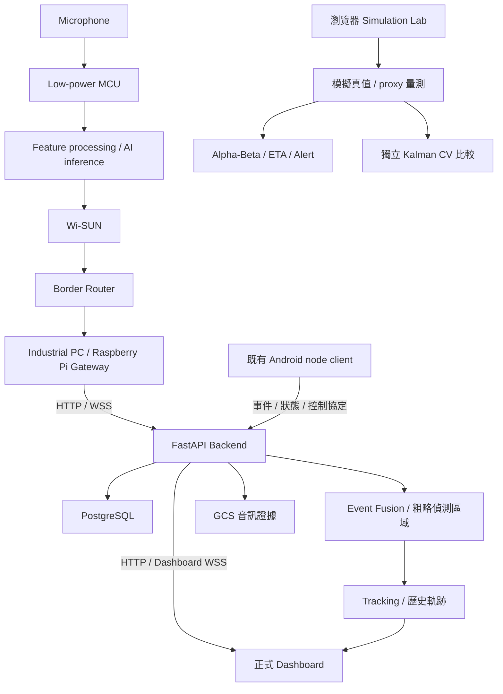

# 系統架構與責任邊界

以 [2026-11-07 Demo baseline](DEMO_BASELINE_2026-11-07.md) 為準。

Gateway 圖是目標整合架構，不表示 MCU／Wi-SUN 真實場域鏈路已在此 repo 完成。Android 上傳／控制路徑是既有介接；Flutter 實驗分支不是本 Backend baseline 的一部分。

## 系統邊界

| 元件 | 責任 | 本 repo 範圍 |
|---|---|---|
| MCU／Microphone | 取樣、capture timestamp、特徵、推論、序號、時鐘 | 契約與驗證需求；韌體在外部 |
| Wi-SUN／Border Router | 無線封包與網路連線 | 外部供應商／網路責任；網路 ACK 不等於 DB commit |
| Gateway | 格式轉換、穩定 ID、時間語義、持久重送、HTTP／WSS | 正式 adapter 尚需共同定義與驗證 |
| Backend | 驗證、授權、持久化、融合、狀態、追蹤、API | 主要實作責任 |
| Dashboard | 監控、證據、地圖、歷史回放與場景展示 | 本 repo；Simulation 狀態與即時資料分離 |

## Backend 模組

| 路徑 | 責任 |
|---|---|
| [`../main.py`](../main.py) | routes、設定、DB pool／SQLite、事件處理、背景工作；仍含 legacy Dashboard |
| [`../app/protocol/`](../app/protocol/) | node envelope、訊息類型、binary audio frame |
| [`../services/event_fusion.py`](../services/event_fusion.py) | label／時間分組、group observations、融合與區域更新 |
| [`../services/region_localization.py`](../services/region_localization.py) | 節點連線／凸包等粗略聲源區域，不是高精度聲學定位 |
| [`../services/tracking/`](../services/tracking/) | Alpha-Beta 位置／速度、gate、排序及歷史點 |
| [`../services/localization/`](../services/localization/) | Timestamp-TDOA、GCC-PHAT、WAV、座標轉換原型；正式 `LOCALIZATION_ENABLED=false` |
| [`../services/realtime/`](../services/realtime/) | in-memory node／command／audio managers |
| [`../services/classification.py`](../services/classification.py) | 五類 metadata 驗證與 server normalization；不負責 MCU 模型訓練／推論 |
| [`../services/audio_evidence.py`](../services/audio_evidence.py) | 已存在且可取得的音訊證據讀取／分析 |
| [`../services/dashboard_v2_4.py`](../services/dashboard_v2_4.py)、[`../templates/`](../templates/)、[`../static/`](../static/) | 按 flag 注入模板、樣式、操作與模擬腳本 |
| [`../services/events/`](../services/events/) | event-driven／Redis shadow 契約及可選 adapter，尚未取代 canonical 正式 pipeline |
| [`../services/observation_shadow.py`](../services/observation_shadow.py) | shadow observation、replay／排序；不取代正式 alert path |
| [`../migrations/`](../migrations/) | 歷史 schema 演進，禁止自行重跑或倒退 |

## 資料語義與限制

`/events` 先持久化 metadata，再排程 post-ingest 並更新 Dashboard。HTTP 成功不等於 fusion、tracking、音訊或所有瀏覽器畫面已完成。固定節點位置、GPS、effective location、偵測區域與真實目標座標不可互換。

正式據點／警戒半徑存於目前瀏覽器；固定節點設定使用 `/device-locations`。模擬使用獨立狀態與計時器；真值產生 proxy 量測，Alpha-Beta／Kalman 各有獨立 state／trail。prediction 讀 Alpha-Beta `trackState`，Kalman 不接管 ETA／警示；清除／重置會一併清除 Kalman state。

WebSocket managers、部分 cache／dedupe 與背景工作位於單程序記憶體。以單 worker 為基準；加入 Redis 套件不等於完成多 worker／多 instance 一致性。擴展須另案驗證 pub/sub、ordering、durable recovery、idempotency。

完整實地驗證界限見 [Research status](RESEARCH_STATUS.md)，既有 Android 路徑細節見 [歷史架構](architecture/final_system_architecture.md)。
